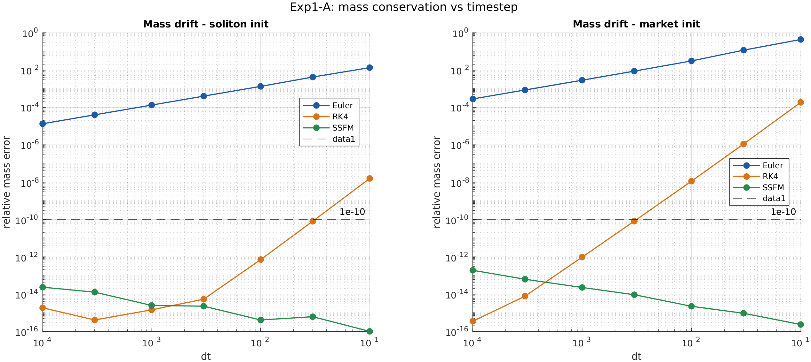
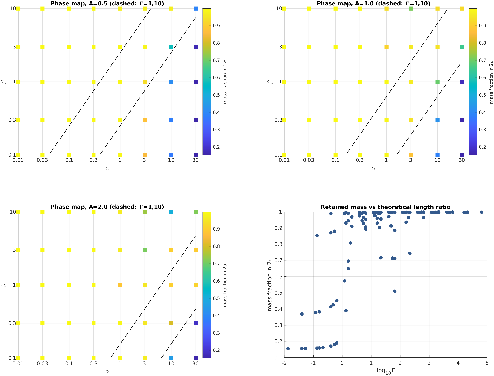
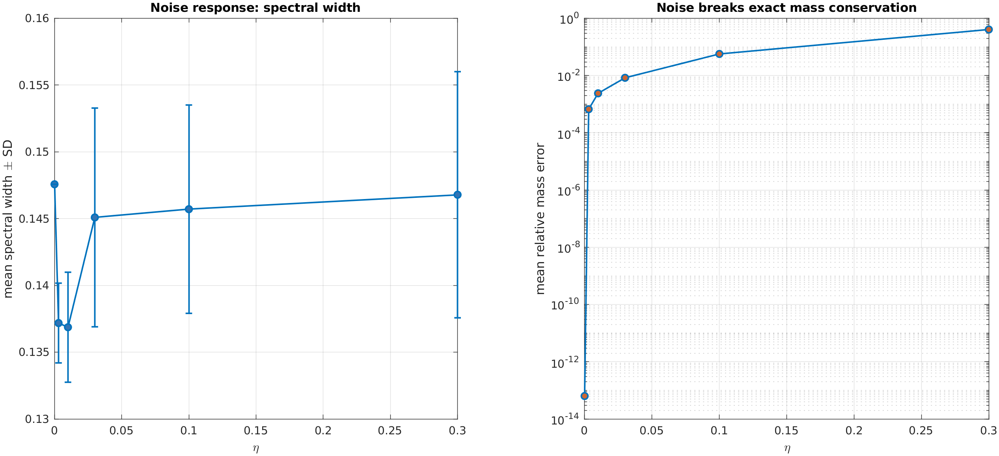
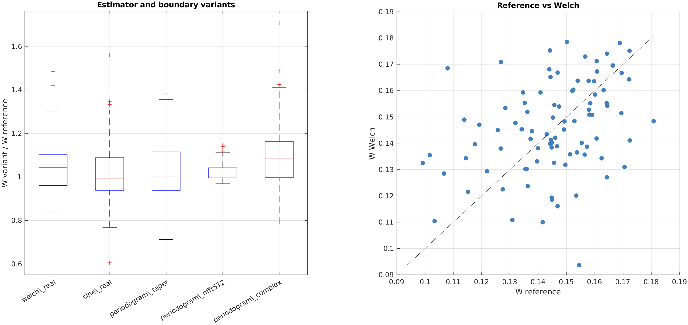

# NEMT 三项数值实验结论

## 研究范围

本册总结 2026 年 10 月 17 日完成的三项 NEMT MATLAB 数值实验。实验运行于 AWS `ip-172-31-43-176`（8 核、30 GB），使用 MATLAB R2023b Update 11。全部输入均为合成数据与受控数值实验，不包含真实 BTC 或其他市场数据。

因此，本册回答的是三个方法论问题：NLS 数值求解是否可信，参数效应是否可识别，以及谱宽是否足够稳健。它既不验证 NEMT 的市场解释，也不直接检验 H001。

## 总体判定

| 实验 | 通过情况 | 核心结论 |
|---|---:|---|
| 实验一：求解器稳定性 | 5/5 PASS | SSFM 可作为当前定量实验的数值基线；Euler 不可靠 |
| 实验二：参数相图与可识别性 | 3 PASS / 1 FAIL | 相图、MI 与局部可识别性成立；噪声展宽叙事不成立 |
| 实验三：ψ 构造与谱宽定义 | 2 PASS / 3 FAIL | ψ 构造有效，但谱宽对估计器、窗口及未来波动率均不稳健 |

最重要的总体结论是：数值求解器这把“尺子”通过了自检，但谱宽这一候选观测量尚未通过稳健性检验。后续研究可以继续使用 SSFM，却不能把谱宽默认视为稳定、可迁移或具有预测价值的市场指标。

## 实验一：数值求解器通过基线验证

SSFM 的相对质量误差为 `2.21×10⁻¹⁵`，达到机器精度；Euler 在 `dt=0.01` 时的相对质量误差为 `3.06×10⁻²`，即约 3.1%。SSFM 孤子模长最大偏差为 `1.15×10⁻³`，1024 点与 512 点网格的谱宽相对差为 `4.54×10⁻³`。MATLAB 与独立 Python 黄金样本的最大误差为 `3.24×10⁻¹³`。

这些结果支持两项工程决策：第一，SSFM 可作为后续 NLS 演化与谱宽计算的默认求解器；第二，当前显式 Euler 实现不得用于定量谱宽结论。

### 稳定性扫描的解释边界

预注册协议固定总演化时间 `T=0.2`，并令步数为 `round(0.2/dt)`。当 `dt` 较大时，演化只剩一到两步，因此所有求解器、所有 `(N, dt)` 组合都未触发发散判据，`dt_c(N)` 全为 NaN。

这不是 Euler 稳定的证据，而是协议没有足够长的演化来定位稳定性边界。Euler 已出现 3.1% 的质量漂移，足以说明其当前实现不可靠。若研究目标转向临界步长，应另行预注册固定步数扫描，例如每个点运行 200 步；不能把本次空白稳定性图解释为稳定域。

## 实验二：参数结构成立，噪声展宽失败

高斯波包相图中，`log Γ` 与局部质量占比的 Spearman 相关为 `ρ=0.839`，并出现 dispersive、mixed 与 localized 三类动力学。调制不稳定性实验得到 14 个有效模式，数值增长率与解析增长率的中位相对误差为 `1.96%`。局部参数可识别性的奇异值比 `s₂/s₁` 中位数为 `0.515`，高于预注册阈值 `0.1`。

因此，在当前基线邻域与四个选定可观测量下，α 与 β 是局部可分别识别的。这一结论只对局部邻域成立，不能外推为全局可识别性。

### 噪声没有造成单调谱宽展宽

当噪声强度 η 从 0 增至 0.3 时，平均谱宽由 `0.1476` 变为 `0.1468`，Spearman 相关仅为 `0.086`。与此同时，质量误差上升至 `0.406`，能量误差约为 `1.03`。

噪声明确破坏了守恒，却没有在当前尺度范围内让谱宽单调增加。因此，“噪声必然导致谱宽展宽”不能继续作为默认理论叙事；若后续仍提出这一机制，应重新定义噪声模型、尺度区间与观测量，并作为新实验预注册。

### MI 修复记录

首次全量运行时，MI 子程序没有把每一组 `(α, β)` 写回求解器，导致所有模式得到同一个增长率。该缺陷已修复，并对实验二完整重跑。本册引用的 14 个有效模式和 `1.96%` 中位误差均来自修复后的结果。这个修复说明参数循环必须通过独立断言验证，不能仅依靠最终图形发现参数未生效。

## 实验三：谱宽尚不是稳健观测量

五种 ψ 构造在 360 个窗口上的演化后谱宽均为有限值。`zero_imag` 与 `logprice_z` 的配对谱宽 Spearman 仅为 `0.395`，中位相对差为 `63.8%`，说明虚部构造会实质改变结果，而不是无关装饰。

但是，谱宽没有通过三个关键稳健性检验：

1. 不同谱估计器与边界处理相对于参考周期图的窗口级 Spearman 中位数只有 `0.366`，低于 `0.8` 阈值。
2. 八种非参考窗口设置中，只有两种与参考排序的 Spearman 大于 `0.7`，低于至少六种通过的预注册标准。
3. 控制当前已实现波动率后，演化后谱宽对未来 24 根波动率的 HAC 回归 t 统计量仅为 `0.0033`，偏相关接近零。

这意味着当前谱宽在绝对偏差不大时，仍可能因为窗口间差异小于估计噪声而改变排序。任何后续市场研究若继续使用谱宽，必须先固定 ψ 构造、谱估计器、边界处理和滚动窗口，并完整报告敏感性分析。

“没有增量信息”也不等于 H001 已被否证。本实验使用合成 GARCH 路径，没有真实 BTC 数据、样本外预测或事件研究。严谨的表述只能是：在当前合成数据、观测语言与参数下，没有证据表明谱宽包含超越当前波动率的未来信息。

## 科学结论与决策

### 可以保留

- SSFM 作为 NLS 定量实验的基线求解器。
- MATLAB 与 Python 黄金样本交叉验证机制。
- 相图与 MI 解析增长率作为数值实现的机制级校验。
- α、β 在当前基线邻域中的局部可识别性结论。
- FAIL 作为有效科学结果，不因工程目标而调整阈值。

### 暂停主张

- Euler 在当前设置下可用于定量分析。
- 本次稳定性扫描证明存在宽广稳定域。
- 加性噪声必然让谱宽单调增宽。
- 谱宽具有跨估计器、跨窗口的稳定排序。
- 谱宽天然包含未来波动率的增量信息。

### 下一步最小实验链

1. 用固定步数协议重新测量 `dt_c(N)`，将稳定性边界问题与固定总时间协议分离。
2. 为参数循环增加“求解器实参确已更新”的自动断言，防止 MI 类缺陷回归。
3. 在真实 BTC 数据上预先冻结 ψ 构造、谱估计器、窗口和预测期，再进行样本外 H001 检验。
4. 将谱宽与更直接的观测量并列比较，包括当前波动率、频谱熵、谱质心及尾部质量。
5. 报告全部 PASS 与 FAIL，并保留参数、随机种子、CSV、图和运行日志。

## 复现与来源

完整交付包为 `nemt_matlab_results_20261017.zip`，压缩包 SHA-256：

`9068adfd31494b6013b23717baa8c66e3f7f2764ae5332fd0a8db63d9bbe55e5`

原始判定来自三个实验目录下的 `exp*_verdict.csv`。完整报告、38 个 CSV、13 组 PNG/PDF/SVG/FIG 图和运行日志均保存在同一交付包中。本册是对正式报告的结论性整理，不替代原始 CSV 与实验日志。

---

版本：1.0  
实验日期：2026-10-17  
整理日期：2026-10-17
