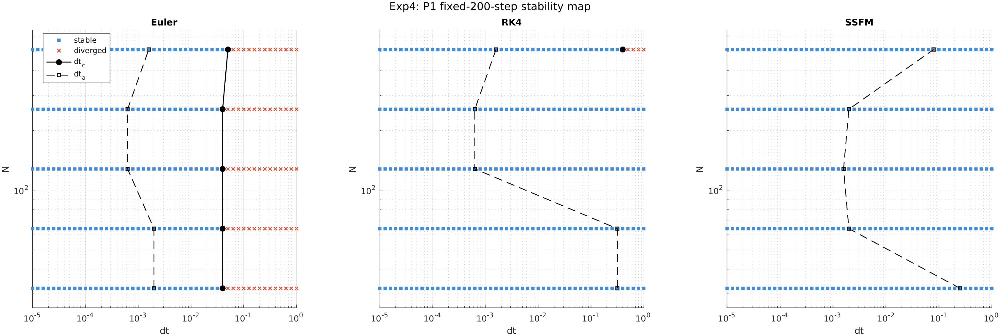
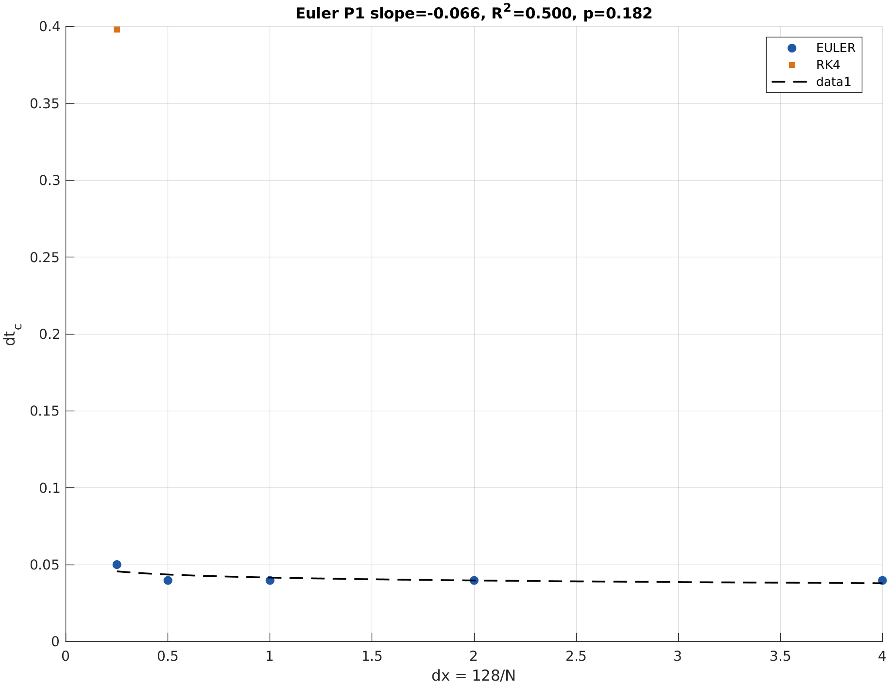
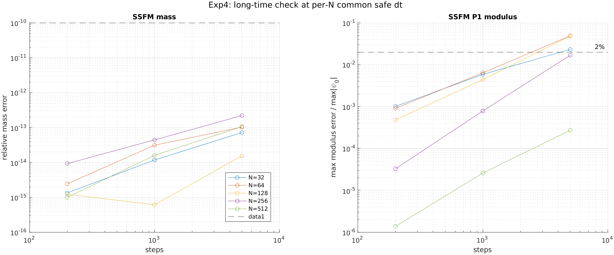
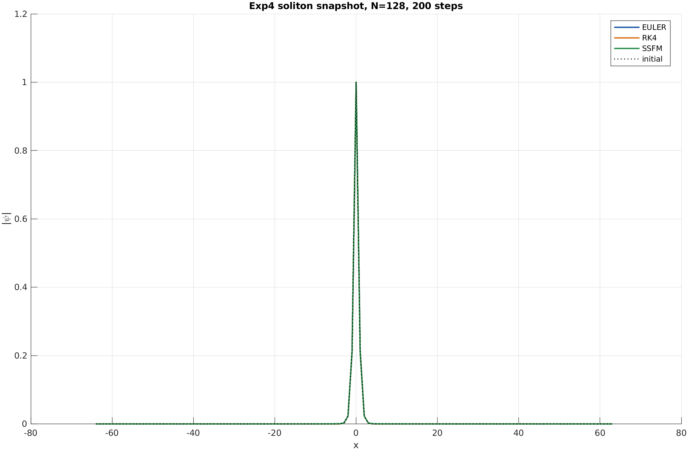

# NEMT 下一组三项实验：实验四门控结果

## 运行身份与最终状态

- 正式运行：`20261017T073704Z`
- 环境：MATLAB R2023b Update 11，Linux AWS，8 个可用处理器
- 代码树 SHA-256：`73d20102a8c0cc6e2e584b1cb691045af2547d82af148037146810c61160281d`
- 最终状态：**BLOCKED**

阻断原因不是代码测试失败，而是冻结协议中的实验四长时可信门控没有通过。实验五、实验六因此按预注册规则停止；真实 BTC 测试段没有被模型打开或评分，不存在 H001 的确认性市场结果。

## 工程验收

六项强制测试全部通过：参数写入、时间对齐、上一组 C5 黄金样本逐点一致、谱指标解析方向、固定 seed 可复现，以及 quick 模式不改变公式、阈值或列名。

实验四完成了 `5 N × 51 dt × 3 solver × 2 初值 × 200 步` 的完整扫描，并执行长时间段和探索性二分。所有图均由保存后的 CSV 重建。正式运行目录含 manifest、环境记录、配置、逐点 CSV、verdict、运行日志和 SHA-256 清单；本地复核全部哈希一致。

## 正式判定

| 判据 | 观测值 | 冻结阈值 | 状态 |
|---|---:|---:|---|
| C4.1 边界可测 | 5/5 个 N 获得有限 `dt_c` | ≥4/5 | PASS |
| C4.2 功率律缩放 | R²=0.500 | ≥0.80 | FAIL |
| C4.3 SSFM 质量守恒 | 3.56×10⁻¹⁴ | <10⁻¹⁰ | PASS |
| C4.4 精度先于发散 | 5/5 个 N | ≥4/5 | PASS |
| C4.5 长时可信 | 最大模长误差 4.91% | <2% | FAIL |
| 实验五 | 前置门未通过 | — | BLOCKED |
| 实验六 | 前置门未通过 | — | BLOCKED |

该结果给出一个明确的方法论结论：质量守恒只是必要条件，不是长期形状可信的充分条件。SSFM 可以将质量保持在约 `10⁻¹³`，但同一次运行仍可产生超过冻结阈值的孤子模长形变。

## 边界扫描

Euler/P1 的边界与精度阈值如下：

| N | dx | dt_c | dt_a |
|---:|---:|---:|---:|
| 32 | 4.0 | 0.0398107 | 0.00199526 |
| 64 | 2.0 | 0.0398107 | 0.00199526 |
| 128 | 1.0 | 0.0398107 | 0.000630957 |
| 256 | 0.5 | 0.0398107 | 0.000630957 |
| 512 | 0.25 | 0.0501187 | 0.00158489 |

全部五个 N 都识别到有限 Euler 发散边界，C4.1 因而通过；全部五个 N 也满足 `dt_a<dt_c`，证明精度在显式发散之前已经失效。数值求解不能以“没有 NaN、没有爆炸”为可信标准。

## 功率律缩放失败

Euler/P1 的 `log(dt_c)` 对 `log(dx)` 回归结果：斜率 `−0.0664`、R² `0.500`、p=`0.182`、95% CI `[−0.1885,0.0556]`。P2 的 R² 达 `0.800`，但斜率为 `0.133`，仍不接近预期的二次缩放。

因此，本扫描没有支持 `dt_c∝dx²`。在固定 200 步协议和 P1 条件下，边界更像由非线性或质量增长触发，而非简单的线性色散 CFL 型边界。C4.2 是有效 FAIL，不能通过选择 P2 或换回归口径改写为 PASS。

## 长时可信门控失败

长时段采用每个 N 在 200 步扫描中同时满足两种初值、三种求解器稳定性与精度条件的最大共同安全步长。SSFM/P1 在 5000 步的结果为：

| N | 共同安全 dt | 模长误差 | 质量误差 |
|---:|---:|---:|---:|
| 32 | 5.012×10⁻⁴ | 2.32% | 7.2×10⁻¹⁴ |
| 64 | 5.012×10⁻⁴ | **4.91%** | 1.0×10⁻¹³ |
| 128 | 5.012×10⁻⁴ | **4.85%** | 1.5×10⁻¹⁴ |
| 256 | 1.585×10⁻⁴ | 1.69% | 2.2×10⁻¹³ |
| 512 | 6.310×10⁻⁵ | 0.027% | 1.1×10⁻¹³ |

N=32、64、128 超过 2% 阈值，其中 N=64 的 4.91% 是正式最大值。质量误差全部远低于 `10⁻¹⁰`，说明失败只来自长时形状保持，而非质量守恒。

200 步的快照仍几乎重合，这正是长时门控存在的理由：短时视觉一致不能替代长时误差测量。

## 协议歧义与允许的解释

冻结文档没有精确定义“共同安全步长”的选择规则。本次实现选择 200 步精度边界内的最大共同 dt。这是合理且可审计的实现，但不是唯一可能定义。

探索性补充显示，在 N=64、128 使用 `dt=10⁻⁴`、5000 步时，模长误差约为 0.64% 和 0.44%，说明更小步长路径可能通过。然而这些数字不属于正式运行，不能事后替换本次 C4.5。若要继续，必须先发布新预注册版本，冻结一个面向 5000 步的保守步长规则或更高阶 Strang splitting，再从实验四头部完整重跑。

## 实验五、六的科学状态

实验五的 `C5.0_exp4_gate` 为 FAIL，其余判据全部 BLOCKED。实验六的 C6.1–C6.5 全部 BLOCKED。虽然 BTCUSDT 1h 数据已经下载并完成完整性审计，但它只用于数据准备，没有进入确认性模型。

BTC 数据范围为 2019-01-01 至 2026-09-30 UTC，共 67,861 行；缺失 59 小时且全部位于 2019–2023，正式测试段无缺失。合并文件 SHA-256 为 `4b92d237501a9d8d36269502e8b0442b07b07ba128fd0e558283c9cec9e67c7f`。这些事实不构成实验六结果。

门外开发扫描提示，即使实验四通过，实验五仍很可能阻断：IPR 的最差过程稳健性为 0.648，最佳 ICC 为 0.066，已知状态响应最好只覆盖 1/4 过程；没有指标同时通过 C5.1–C5.4。这些数据只能用于新预注册设计，不能进入正式 verdict。

## 结论

1. 固定步数扫描成功识别 Euler 边界，并证明精度失效早于显式发散。
2. 预期的 `dt_c∝dx²` 没有得到支持；当前边界不能简化为该功率律。
3. SSFM 的机器精度级质量守恒不保证长期形状可信。
4. 当前“最大共同安全 dt”在 5000 步下导致最高 4.91% 模长误差，C4.5 正式失败。
5. 实验五、六按协议 BLOCKED；没有真实 BTC 样本外 H001 结论。
6. 下一步不是绕过门控，而是重新预注册长期步长安全因子或高阶分裂方案，并从实验四重新运行。

本次 BLOCKED 是有效科学结果：它阻止了尚未通过长期数值可信性和观测量稳健性验证的模型接触确认性市场测试段。

---

实验日期：2026-10-17  
正式运行：`20261017T073704Z`  
状态：`BLOCKED`
