# NEMT Studio — UI/UX Refactor Delivery

**Date:** 2026-10-17  
**Route:** `/trade`  
**Scope:** Phase 1 layout/system, Phase 2 strategy-only execution workbench, Phase 3 responsive/quality, Phase 4 verification.  
**Constraint respected:** No backend rewrite, database migration, trading-engine change, or new UI dependency.

## 1. Delivered

### Application shell

- Full-width desktop app shell:
  - collapsible 232px sidebar
  - 60px top bar with pair, live price, feed status, DEMO/TESTNET/LIVE badge, user and settings entry
  - main market/workbench area
  - 344–360px account/execution rail
- Tablet ≤1279px: icon-only navigation rail.
- Tablet 1180px / 900px: chart, account and execution panels reflow into stacked workspaces.
- Mobile <768px: independent single-column layout, touch-sized controls, drawer navigation and five-item bottom bar.
- Seven production surfaces are reachable: Overview, Markets, Trade, Strategies, Orders, Assets, Settings.
- URL state is preserved (`?section=markets`, etc.) and browser back/forward is supported.

### Design system

- Scoped `.nemt-studio` light professional theme.
- Centralized tokens in `web/src/app/studio.css` for:
  - color (`#F6F7F9`, `#FFFFFF`, `#15191E`, `#69727D`, `#E5E9ED`, `#00BED6`, `#13A782`, `#E45461`)
  - type, numeric font, radius, spacing, borders, shadows, breakpoints and layout widths
- Removed grid/slash backgrounds, large decorative gradients, heavy shadows, and the old 560px mobile page-width constraint.
- Unified cards: 1px borders, 8–12px radius, 16–18px padding, minimal shadows.
- Tabular numerics, stable hierarchy, visible focus states and labeled controls.

### Market data

- Replaced the placeholder desktop dashboard with a real market workbench.
- Top bar and Market panel consume the existing `/api/v1/market/ticker` endpoint (5s polling, inherited from existing data hook).
- Multi-timeframe candles (`1m`, `5m`, `15m`, `1H`, `4H`, `1D`) use the existing `/api/v1/market/klines` endpoint.
- Custom responsive SVG chart with:
  - candlesticks, wicks and volume
  - last-price line and price axis
  - hover crosshair and OHLC readout
  - loading, empty, stale, and error/retry states
- 24H high, low, volume, quote volume and feed freshness are always visible.

### Execution monitoring and account

- **Manual order entry is fully removed.** The former Spot Order form, manual preview/confirmation flow and “new order” shortcuts are no longer part of the UI.
- Execution is strategy-driven: Studio has no manual order-creation surface and monitors the resulting orders, fills and balances.
- The account rail now contains Account Summary and an Execution Policy card that states the manual-entry policy, order source, server-side checks and retained monitoring/cancel controls.
- Account summary shows total equity, available USDT/BTC, sync status and DEMO ledger label.
- Spot unrealized PnL is intentionally omitted because no defined spot PnL metric exists.
- Open Orders / Order History / Trade History tabs use real order/fill data; cancellation remains available for open strategy orders, with confirmation.
- `useTradingData` and all API endpoints are unchanged.
- Demo/live isolation remains server-controlled. The frontend has no environment switch and LIVE writes remain disabled by the server.

### Navigation scope

- Theoretical Research and Cloud Experiments are intentionally excluded from the trading workbench; they belong to internal/backstage systems and are not exported through navigation or deep links.
- Direct legacy URLs such as `?section=research` resolve safely to Overview.
- Strategies remains as an explicitly marked `UI FOUNDATION` / `未接入` surface without fabricated performance or running states.

## 2. Live Deployment

**URL:** https://postyouth.club/trade  
**Server app:** `/opt/nemt-app/web`  
**Services:** `nemt-web.service` (Next.js, `127.0.0.1:3101`), `nemt-api.service` (`127.0.0.1:8101`)  
**Host:** 103.144.246.242

The public site had been serving the 20:01 build, which did not contain the Studio source. It was synced on 2026-10-17 at 14:38 UTC, then updated with the research/experiment navigation cleanup at 14:48 UTC and the manual-order removal at 14:57 UTC:

- uploaded only the changed frontend paths;
- built on the server with Node 20 as the `nemtapp` user;
- restarted `nemt-web.service`;
- verified the new page externally.

Pre-deploy backups:

```text
/root/nemt-web-before-studio-20261017T143805Z.tar.gz
/root/nemt-web-before-nav-cleanup-20261017T144805Z.tar.gz
/root/nemt-web-before-no-manual-order-20261017T145647Z.tar.gz
/root/nemt-web-before-execution-copy-20261017T150337Z.tar.gz
```

Server build logs:

```text
/root/nemt-web-build-20261017T143819Z.log
/root/nemt-web-build-nav-cleanup-20261017T144805Z.log
/root/nemt-web-build-no-manual-order-20261017T145647Z.log
/root/nemt-web-build-execution-copy-20261017T150337Z.log
```

Live verification:

| Check | Result |
|---|---|
| Public HTML title | `NEMT Studio · NEMT` |
| HTTP cache | `private, no-cache, no-store` (`cf-cache-status: DYNAMIC`) |
| DEMO auto-login | Pass |
| Market source | **Binance public data** (live server can reach Binance) |
| Account/orders/klines | Loaded successfully |
| Navigation | Only Overview, Markets, Trade, Strategies, Orders, Assets, Settings |
| Manual order entry | Removed (0 order-form instances) |
| Desktop / mobile overflow | None |
| Browser failures | No failed requests |

The earlier 401 console entry is the expected `/auth/me` probe before the automatic DEMO login.

Live external screenshots:

  
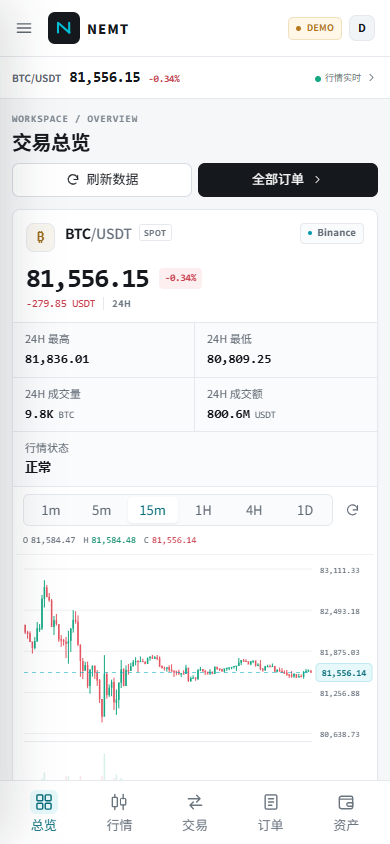

> If an installed PWA still shows the old layout, close all app windows and reopen, or do a hard refresh once. The refreshed page is network-first; old static chunks are not reused because the new build has new asset hashes.

## 3. Screenshots

| View | Screenshot |
|---|---|
| Desktop 1440×900 | 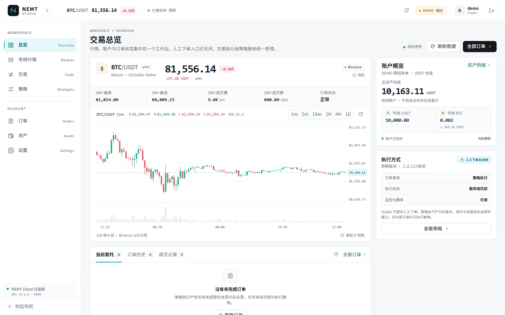 |
| Desktop 1920×1080 | 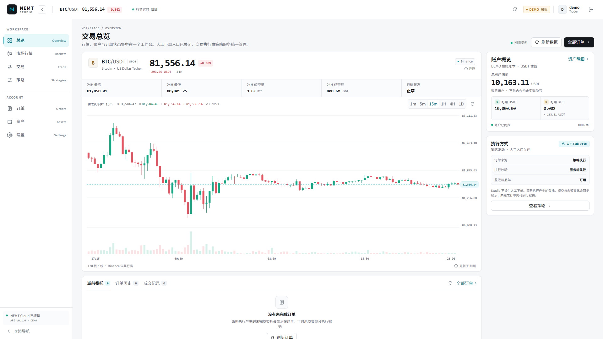 |
| Markets | 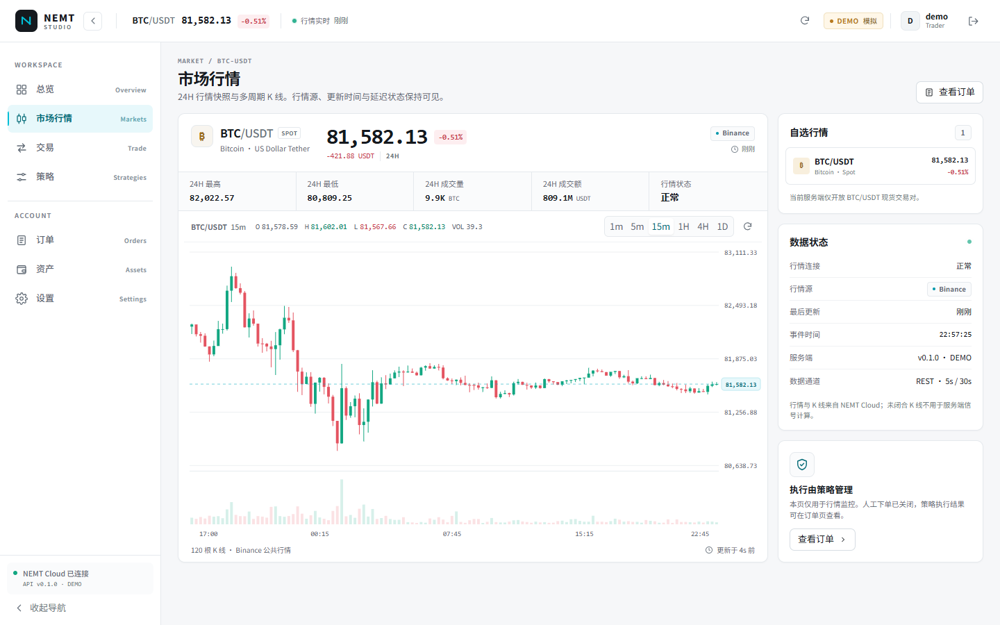 |
| Orders | 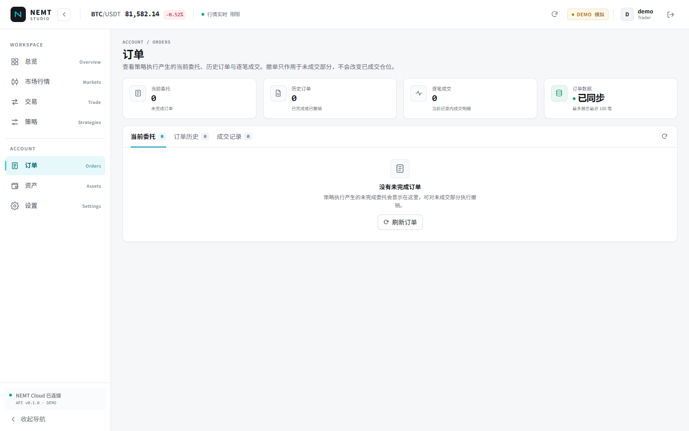 |
| Assets | 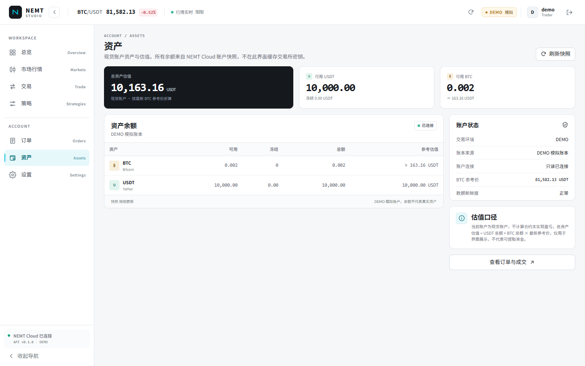 |
| Settings | 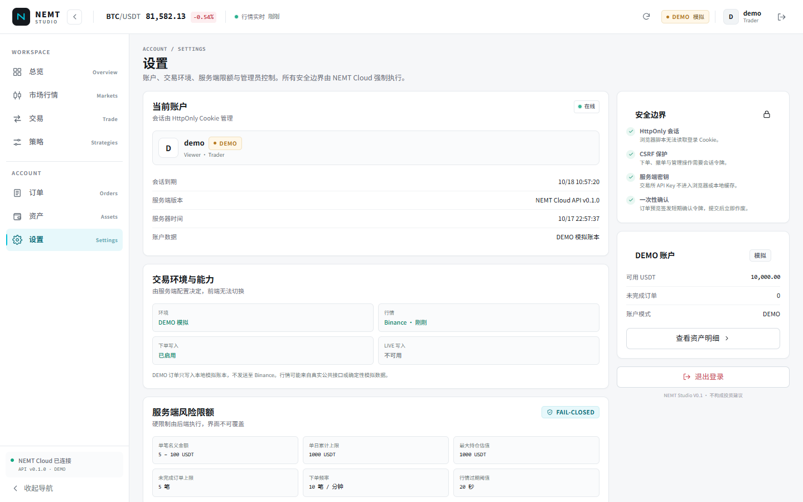 |
| Login | 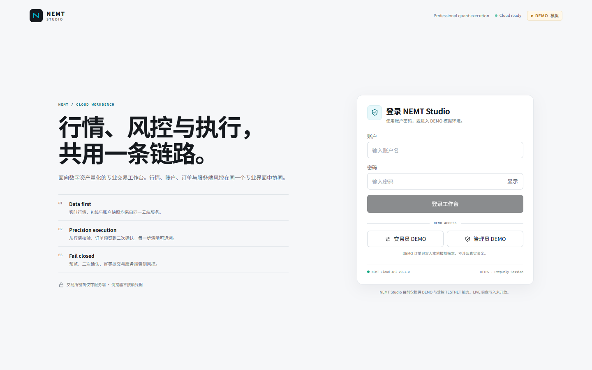 |
| Tablet 1024×768 | 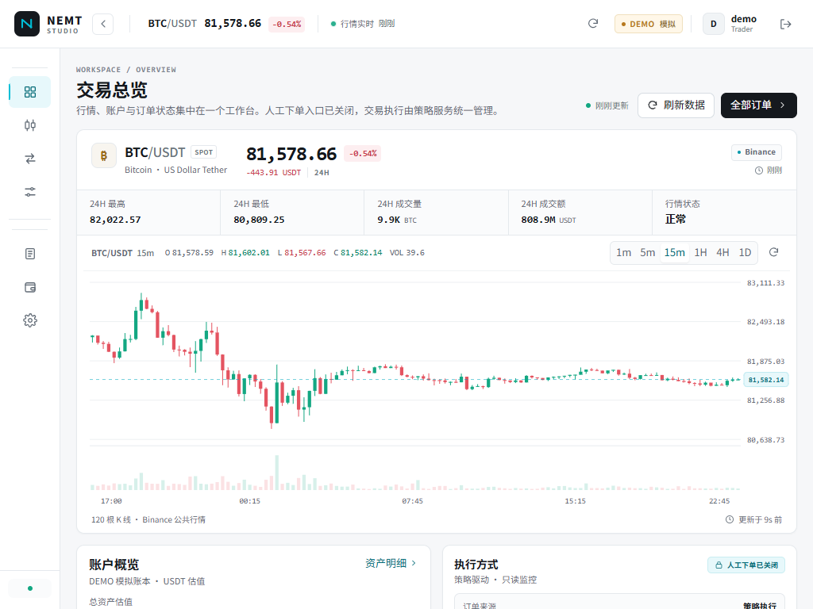 |
| Tablet 768×1024 | 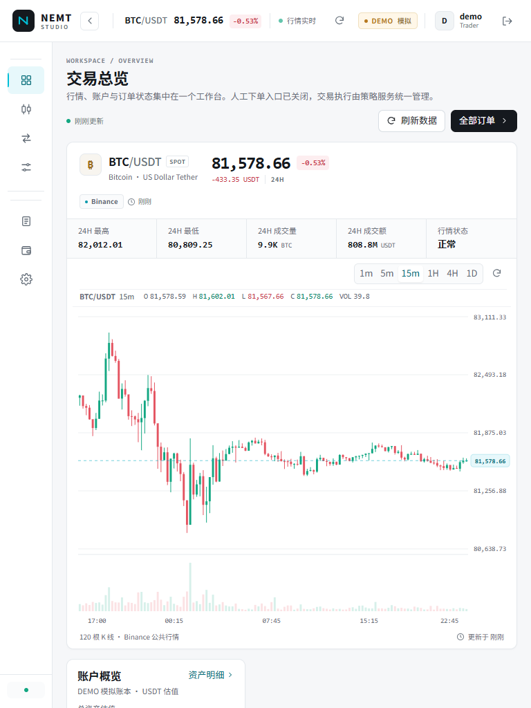 |
| Mobile 390×844 |  |
| Mobile account / execution | 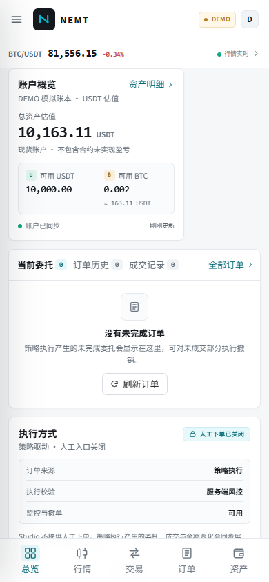 |
| Mobile navigation | 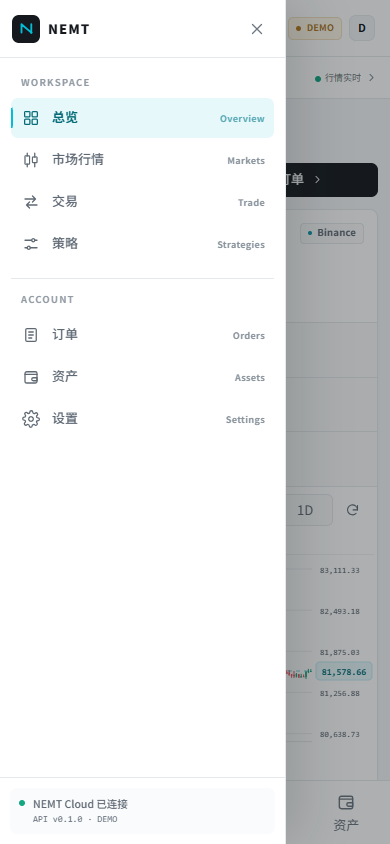 |
| Mobile assets | 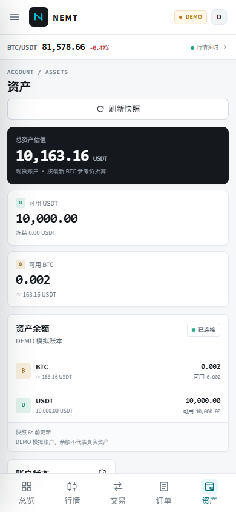 |

All screenshots in this folder were recaptured from the live deployment against real Binance public market data.

## 4. Verification

| Check | Result |
|---|---|
| `npx tsc --noEmit` | Pass |
| `npm run lint` | Pass: 0 errors, 12 pre-existing unused-variable warnings outside the new Studio tree |
| `npm run build` | Pass, all routes compiled; `/trade` is dynamic due to server-read initial login state |
| `python -m pytest backend/tests/test_trade_app.py -q` | 20 passed |
| Browser console across reviewed pages | No errors |
| Horizontal overflow at 390 / 768 / 1024 / 1440 / 1920 | None |
| Manual order UI | Confirmed absent from Overview, Trade, Markets and Orders |
| Live strategy-order monitoring | Account, open orders, order history, fills and cancel read from API |

## 5. Changed Files

### Integration

- `web/src/app/layout.tsx` — imports the scoped Studio stylesheet.
- `web/src/app/trade/page.tsx` — `/trade` now renders `StudioApp`; reads initial login state server-side to avoid hydration mismatch.
- `web/src/components/trade/TradeApp.tsx` — legacy unused mobile component lint-state correction.

### New design system and application

- `web/src/app/studio.css`
- `web/src/components/trade/studio/StudioApp.tsx`
- `web/src/components/trade/studio/StudioLogin.tsx`
- `web/src/components/trade/studio/common.tsx`
- `web/src/components/trade/studio/icons.tsx`
- `web/src/components/trade/studio/navigation.ts`
- `web/src/components/trade/studio/types.ts`
- `web/src/components/trade/studio/layout/StudioSidebar.tsx`
- `web/src/components/trade/studio/layout/StudioTopbar.tsx`
- `web/src/components/trade/studio/market/MarketPanel.tsx`
- `web/src/components/trade/studio/market/MarketChart.tsx`
- `web/src/components/trade/studio/account/AccountSummary.tsx`
- `web/src/components/trade/studio/orders/OrdersPanel.tsx`
- `web/src/components/trade/studio/pages/*` — seven production surfaces plus shared scaffold/workbench components.
- Removed `ResearchPage.tsx` and `ExperimentsPage.tsx`; research and cloud experiments are no longer imported or routable in Studio.
- Removed `OrderForm.tsx` and `OrderConfirmDialog.tsx`; manual order entry is no longer bundled in the client.

The pre-existing untracked, type-broken desktop prototype (`DesktopTradeApp.tsx` + `desktop/`) was superseded by the Studio component tree. Pre-existing working-tree edits to legacy trade components were left intact.

## 6. Data Note

The local execution environment could not reach the Binance public REST endpoint. Local verification and screenshots therefore used the existing deterministic DEMO data source. The deployed server **can** reach Binance, and the live page was subsequently verified against real Binance public market data:

```bash
NEMT_APP_MODE=DEMO NEMT_MARKET_SOURCE=demo NEMT_DATABASE_PATH=backend/.data/<temporary>.sqlite3 \
  python backend/trade_main.py
```

The application still calls the same NEMT Cloud API routes and already labels simulated market data as `模拟行情`. No frontend change is required when Binance connectivity is restored. The temporary preview database was removed after verification.

## 7. Not Implemented / Intentionally Out of Scope

- Binance connectivity and API-key configuration — pending environment access/credentials.
- Strategy execution and live strategy instances remain a separate backend concern; the Studio client now only monitors their output.
- Research and cloud-experiment functionality remains backstage and is intentionally not exposed in the Studio UI.
- LIVE trading; remains blocked server-side.
- Order book/depth, stop orders, OCO, futures, and other APIs absent from the existing backend.
- Manual spot order entry is intentionally unavailable by product policy.
- WebSocket market streaming (existing REST polling intervals preserved: ticker 5s, K-lines 30s).
- Contract unrealized PnL — spot account has no defined metric.
